# A closer look at the “American Death Triangle”

- Author: John Godino
- Published: 2026-11-13
- Source: [AlpineSavvy](https://www.alpinesavvy.com/blog/a-closer-look-at-the-american-death-triangle)

> Archive note: This archive covers only the publicly accessible portion of the page; the remainder requires Premium Membership. Membership banners and repeated access links are omitted. The publication date is copied from the page metadata. In the real-world forces section, the source switches from 100 kg to 100 pounds; both are preserved as written. Force ratios and safety judgments below are the author’s statements for the configurations discussed, not independently verified general limits.

*This is an updated version of a previous article on this topic.*

---

### Short version:

- The American Death Triangle (ADT) is NOT a preferred method for rigging anchors, but it's not as bad as you might think.
- With anchor angles typical in climbing (under 90 degrees), the ADT puts about 100% of the load onto each anchor point; the exact amount depends on the angle.
- The ADT’s main problem is zero redundancy; if the sling fails, so do you.
- If you have to use one in the wild, provided the sling is in good shape, you're probably going to be fine.

---

**American Death Triangle: top rope setup**

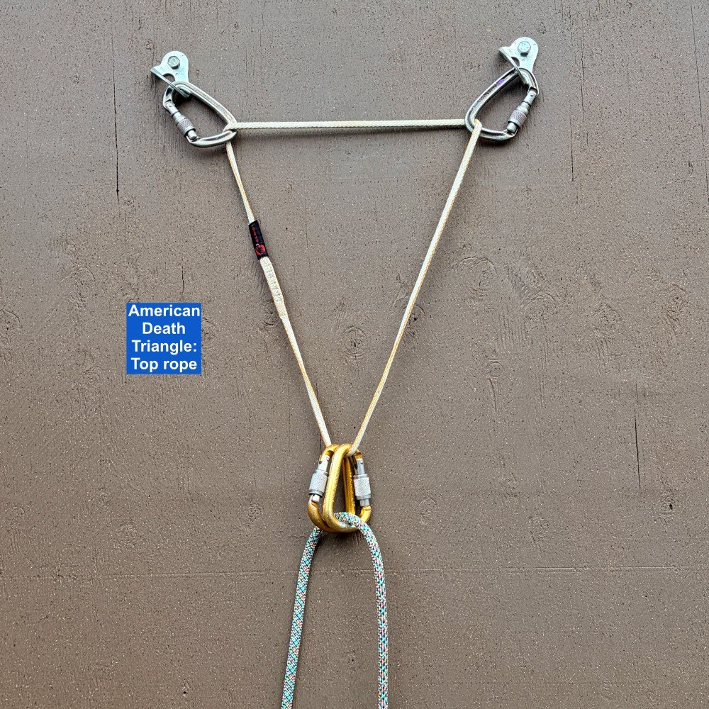

**American Death Triangle: rappel setup**

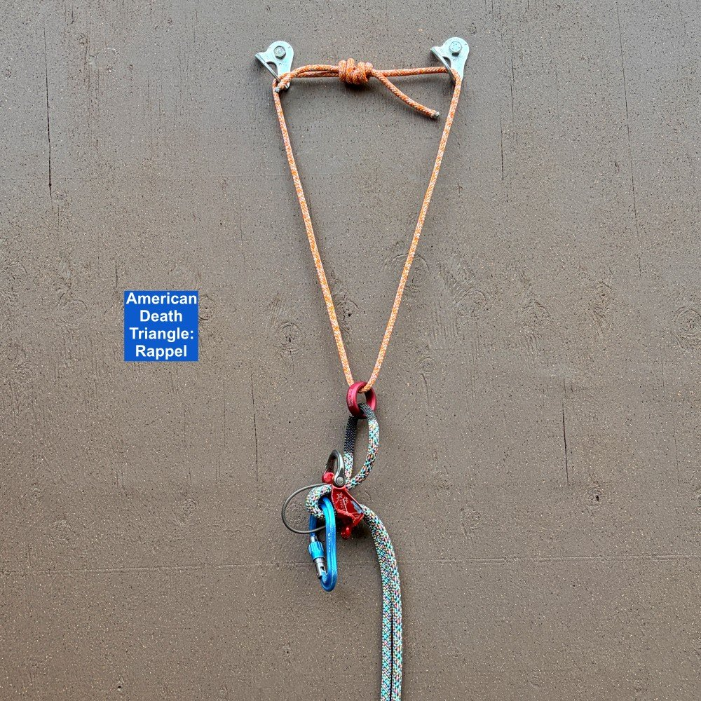

The so-called “American Death Triangle” (“ADT”) in the early days of climbing, was a fairly common way to build anchors. It uses a minimum amount of webbing, and offers good equalization. At first glance it appears to be serviceable, even if it ignored a few basic rules of physics. Plus, you have to admit it's a catchy name!

However, for a long time it’s been roundly slammed in just about every climbing book ever written. ***“Don’t use it! Load multiplication! It creates dangerous forces on the anchors!”*** is usually about the extent of it.

Overall, that’s good advice. There are almost always better options for rigging that are redundant and put lower force on the anchor points.

---

**But, you might wonder, how bad is it, really?**

Before word got out that they weren't so great, ADTs were used for probably tens of thousands of anchors over decades. Did you ever hear of one failing? Are “catastrophic” forces really being created? If someday you have to use one in the wild, is it a YGD (Yer Gonna Die) scenario? What about other related configurations, like rappelling off of side-by-side rings, or lowering off of an adjacent route, or slinging a big boulder, that are sort of the same thing?

**While the ADT may not be as bad as you might think, there are some reasonable concerns** *(listed in rough order of importance)*

- **It’s not redundant.** In the photos above, any failure of the sling/cord means the whole anchor fails. That's the primary problem!
- **It can put a inward / sideways pull on your gear,** which could be an issue. For example, a piton in a horizontal crack could be plenty strong enough for a downward pull, but maybe not for an inward pull. More on that below.
- **It can increase the load onto the anchor points.** The amount of this increase is related to the angle at the bottom of the triangle. It's rarely more than 1X the actual load onto each anchor point. More on that below. If the anchors are reasonably solid, this is probably not a concern.
- **You're only using the strength of a single strand of the material**, instead of doubling it up, which increases the strength.
- **If one anchor point failed, it's likely you’re going to have some extension** onto the the remaining piece, no bueno.

---

**Since load multiplication is the main concern most people have, let's look at that first.** (We’ll keep the physics and math as simple as possible, I promise!)

Pretty much every “Climbing Anchors 101” class has a diagram something like the one below. The smaller the angle between the two legs, the better the load sharing on the anchor points. As you get close to 180°, like on a slackline or Tyrolean traverse, the load multiplication gets ridiculous. This is for sure a good principle to keep in mind for standard anchor building.

Do you remember a vector force diagram like this from your anchor class?  I suspect that this is at the root of the idea that the ADT causes high forces: *“Horizontal rope in anchor ALWAYS equals super duper load multiplication.”*

**However, this does NOT apply to the ADT, where are the load direction is completely different from the diagram below.**

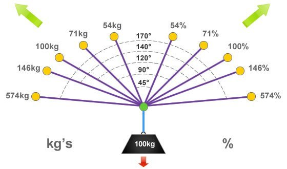

image:  https://www.ropebook.com/information/vector-forces/

---

## Let's check the numbers

Here’s a nice chart from [*“Rock Climbing: The AMGA Single Pitch Manual”*](https://www.amazon.com/Rock-Climbing-Single-Pitch-Manual/dp/0762790040/) by Bob Gaines and Jason Martin. This is the only book I’ve seen with actual data on the ADT.

The second column, “V rigging”, refers to a standard way of clipping a sling to each anchor, making two arms, and then tying it off with a bight knot.

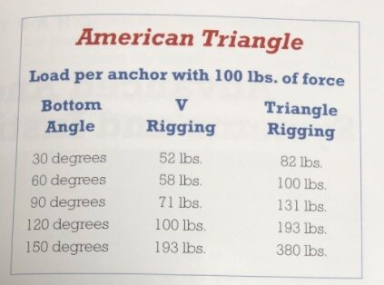

Image:  *“Rock Climbing: The AMGA Single Pitch Manual”* by Bob Gaines and Jason Martin

**Turns out, with a 100 lb load and a small bottom angle of approximately 30°, there’s only 82 pounds of force being put on each leg of an ADT anchor.** That’s a bit more than the 52 pounds or so on each leg with standard “V rigging”, but nothing close to catastrophic.

**Even at a 90° angle, about as large as you would normally want to go, the ADT only puts 130 pounds on each anchor.** Again, not close to catastrophic. (If your anchor placements can't hold 130 pounds, you've got some much bigger problems!)

So check that out, load multiplication is not really a problem!

For you engineers and more visual folks who want to see the math behind this and some nice diagrams, [check out this webpage](https://overtheedgerescue.com/rope-rescue/american-death-triangle/) from our New Zealand friends at Over the Edge Rescue.

---

## Rappelling on adjacent rings?

I've heard this question a few times:  **What about rappelling on adjacent rings? Does that create any sort of a dangerous death triangle?**  Short answer is no. The angle created by your rappel device is quite small. This creates a load on each anchor point that's just a bit more than your body weight. The bolts can easily handle that, plus they can take a load in any direction, so no worries. *(Check out the HowNot2com video link at the bottom, at around 12 minutes, to see some testing on this.)*

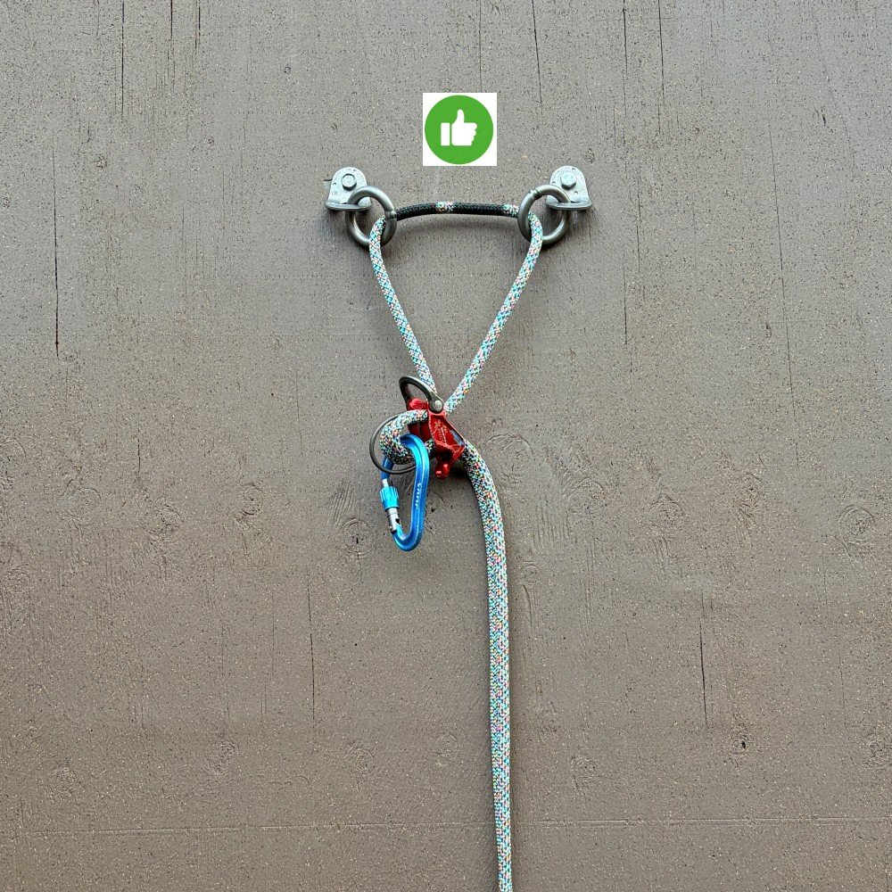

---

## Stone hitch?

Here’s a similar situation. There’s a [Stone hitch](https://www.alpinesavvy.com/blog/the-stone-hitch) tied below the anchor, which isolates each strand of rope, typically so you can rappel on a single strand.

Does this create a dangerous ADT on the anchors? Yes it's an ADT, but with those bolts it’s certainly not dangerous. For rappelling, where the load is never going to be more than 1-2 kN, load multiplication is of no concern.

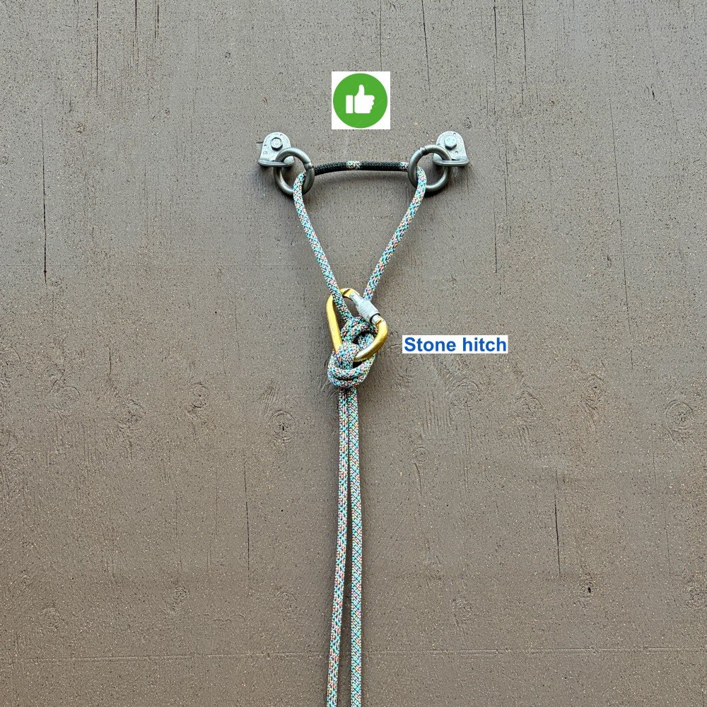

---

### Ice climbing V thread?

Ice climbers use V threads for anchors as standard practice. This is basically an ADT. However, if you make this correctly, in good quality ice, it's so ridiculously strong that the slight increase in forces on the anchor doesn’t matter.

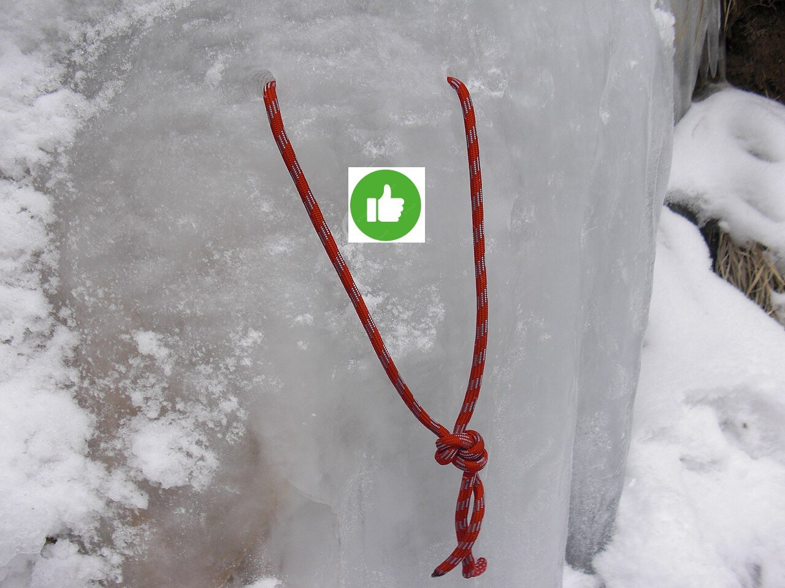

image: By Kumpei Shiraishi - CC BY 2.0, [https://commons.wikimedia.org/w/index.php?curid=62812575](https://commons.wikimedia.org/w/index.php?curid=62812575)

---

## Lowering from an adjacent route?

Scenario: Say you have two different bolt anchors that are the same height at the top of the climb. **If you climb the left route, clip 1 anchor, traverse to the right, clip the other anchor, and then lower off without pulling your rope through the first anchor, are you making any sort of dangerous ADT?**

Answer: no. **A clever engineer friend of mine calculated that the force on each anchor is just a little over the climber’s body weight.** (To be more specific, the right anchor takes about 1.25x the climber’s weight, and the left anchor takes about 0.9x the climber’s weight.) So the takeaway: no problem!

If you do this, be aware that you’ll need more rope to safely lower your partner to the ground, so be SURE your rope is long enough!

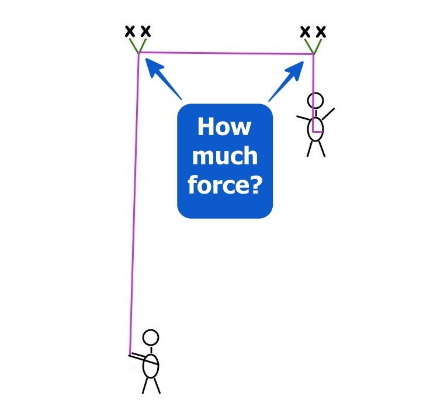

---

## What are the real world forces?

In the “rappel setup” photo near the top of the page, the joining knot of the anchor cord is on the base of the triangle, horizontally between the anchor points.  What are the forces put on this knot?

In the photo below, we have an approximate equilateral triangle, with 60° in each leg, and the joining knot between the two anchor points. Say we have a load of 100 kg hanging off of the anchor. **Will the knot see less than, equal to, or greater than 100 kg? Take a guess!**

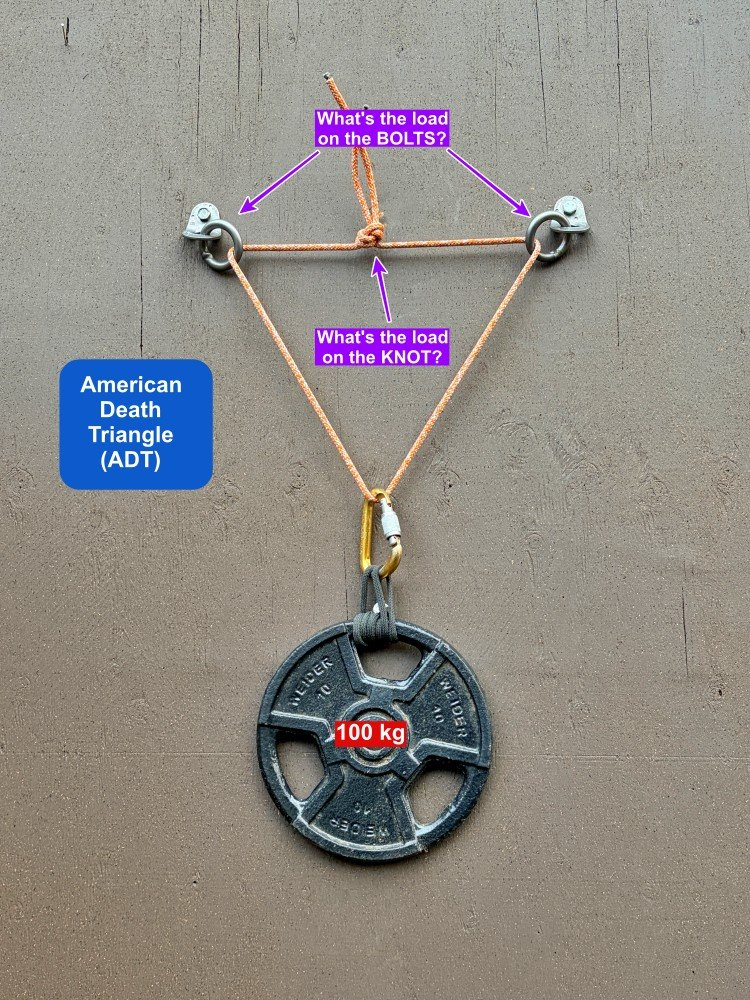

Answer: quite a bit less. That's because the friction on each of the anchor points absorb some of the load. The actual amount depends on the slickeriness of the material you're using, and what it's actually running through at the anchor, but the takeaway is that the base of a triangle sees the lowest amount of force. Is that surprising? It was to me!

(*Note on the photo below: yes I know you could put your rope directly through the rappel rings and ignore the entire ADT rigging, but I needed to set up like this to get a equilateral triangle with the length of cord I had . . .   =^)*

The theoretical force on each bolt would be the same as the load, or 100 pounds. But because the cord is running through the rappel rings, this friction actually reduces the force going to the hangers, which is a good thing. With a 60° equilateral triangle, about 80% of the load goes to the bolt, and about 36% is seen by the knot.

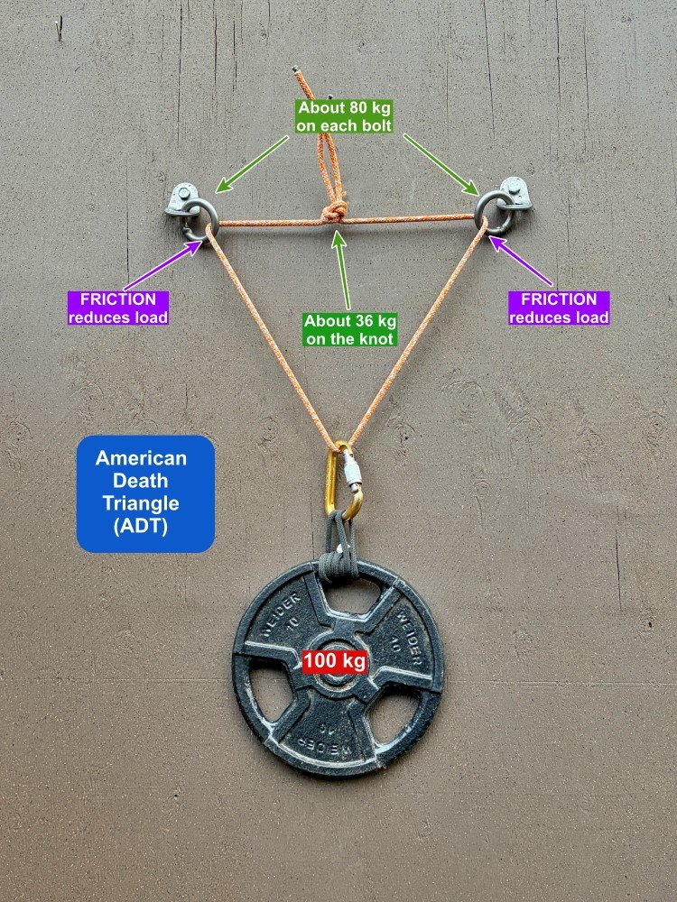

---

### Below is a screen grab from our friends at HowNot2.com who tested pretty much the same set up.

### **With a load of 2.4 kN at the master point:**

- the base of the triangle between the anchor points saw a load of 0.9 kN, **about 36% of the load.**
- each bolt saw a load of 1.96 kN, **about 80% of the load.**

(There's a link to the whole video at the bottom of the page.)

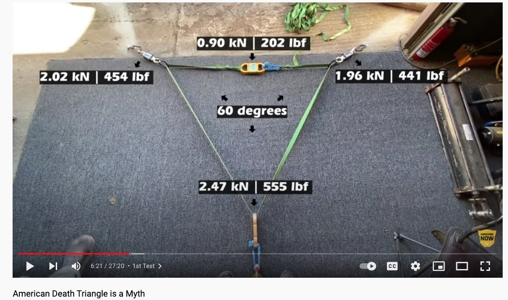

image: HowNot2

---

- *What’s a “resultant”, and how does it apply to this rigging?*
- *What's a particular type of climbing protection where the ADT can cause a problem?*
- *How about a YouTube video with some actual break testing on the ADT?*

### Join my [**Premium Membership**](https://www.alpinesavvy.com/premium) to read the rest of the article.

### Thanks for your support!
