# 深入了解“美式死亡三角”

- 作者：John Godino
- 发布日期：2026-11-13
- 原文：[AlpineSavvy](https://www.alpinesavvy.com/blog/a-closer-look-at-the-american-death-triangle)

> 归档说明：本归档仅包含页面公开可读的部分，余文需要高级会员权限。会员宣传横幅及重复的访问链接已省略。发布日期照录页面元数据。“实际受力”一节的原文先用 100 kg，后改用 100 pounds，本文保留这一单位不一致之处。下文的受力比例及安全判断均为作者针对所述配置的表述，并非经独立验证的通用限值。

*本文是在此前同主题文章基础上更新的版本。*

---

### 简要结论：

- 美式死亡三角（American Death Triangle，简称 ADT）**不是**搭建保护站的首选方式，但它也没有你想象的那么糟。
- 在攀岩常见的保护站夹角下（小于 90°），ADT 会让每个锚点承受大约相当于总载荷 100% 的力；具体数值取决于夹角。
- ADT 的主要问题是完全没有冗余：扁带环一旦失效，你也就失去了保护。
- 如果在野外不得不用这种配置，只要扁带环状况良好，你很可能不会有事。

---

**美式死亡三角：顶绳配置**

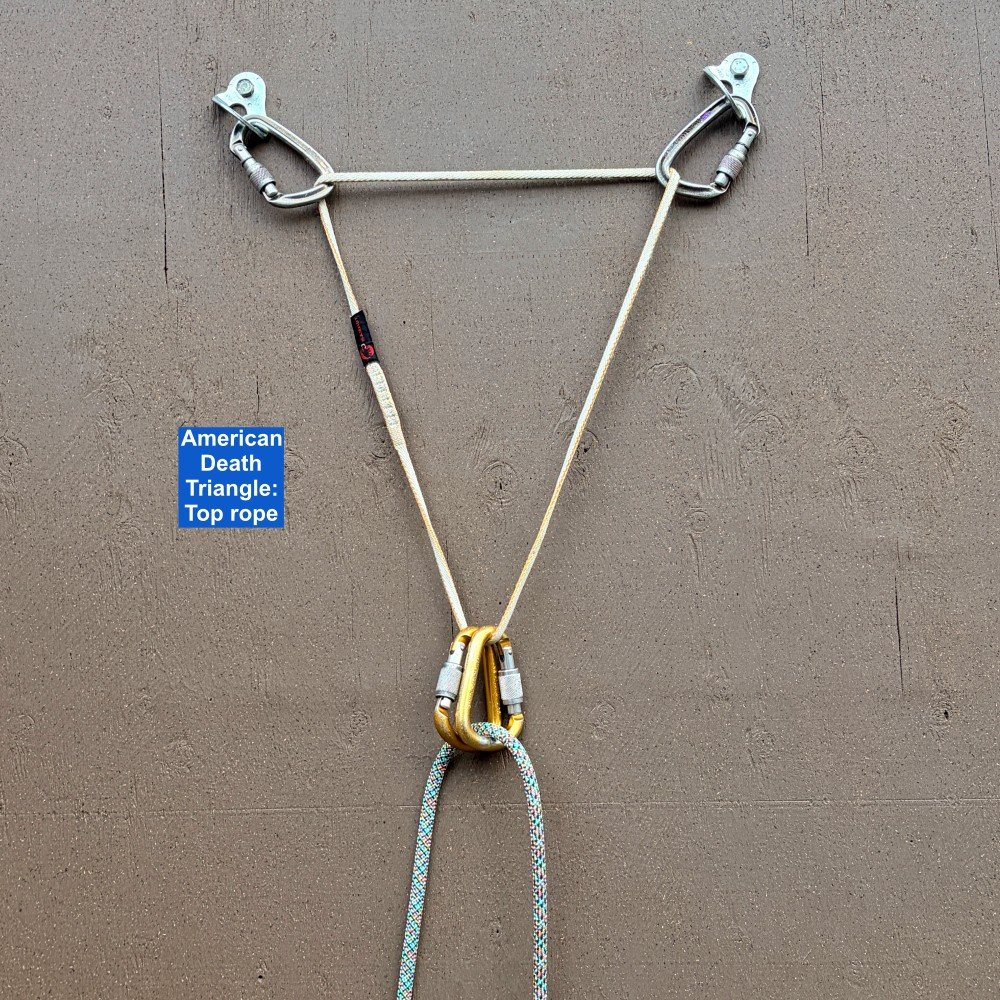

**美式死亡三角：绳降配置**

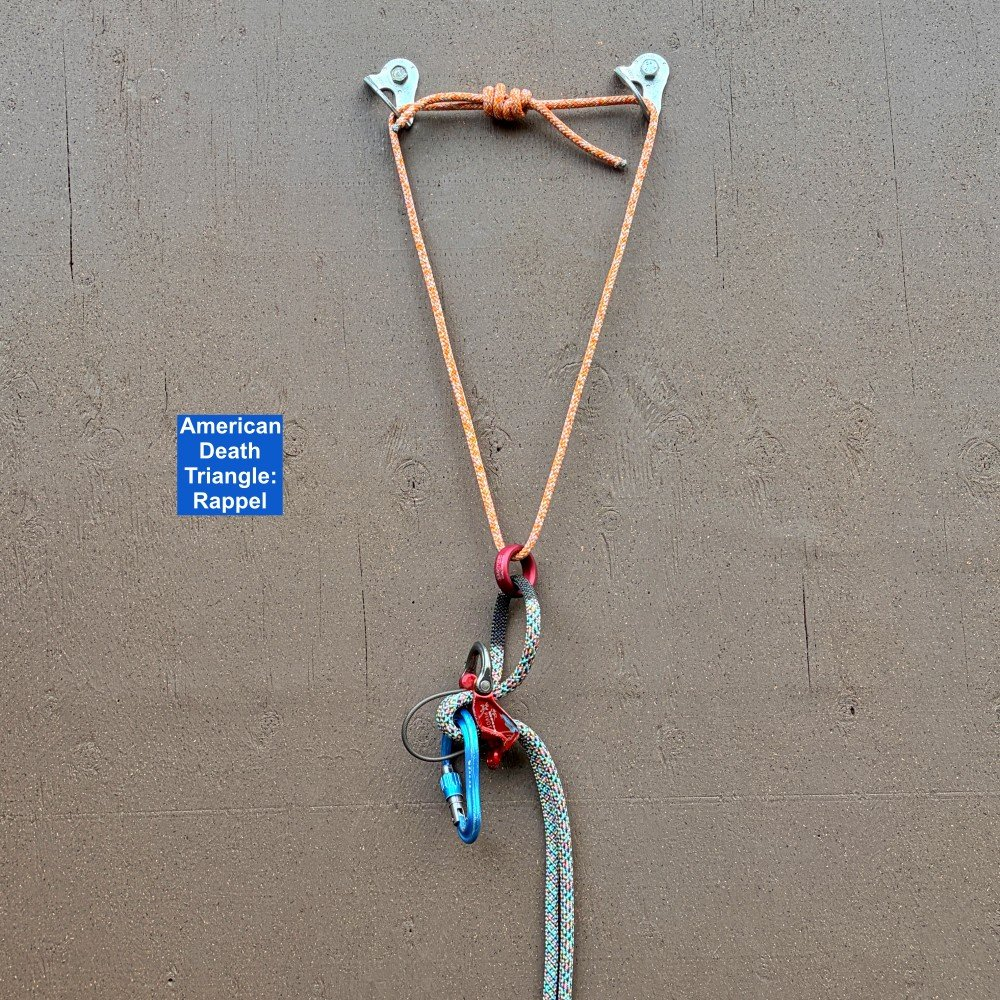

在攀岩运动早期，所谓的“美式死亡三角”（ADT）是相当常见的保护站搭建方式。它只需很少的扁带材料，就能实现良好的均衡受力（equalization）。乍看之下，这种配置似乎能用，尽管它忽略了一些基本的物理规律。另外，你不得不承认，这个名字确实让人过目不忘！

然而，长期以来，几乎每一本攀岩书籍都在猛烈抨击它。说法通常也就这些：***“别用！它会放大载荷！它会让锚点承受危险的力！”***

总的来说，这个建议是对的。几乎总能找到更好的搭建方式，既有冗余，又能让锚点承受更小的力。

---

**但你也许会想：它究竟有多糟？**

在大家意识到这种配置不太理想之前，几十年间，人们可能已经搭建过数以万计的 ADT 保护站。你听说过其中哪个失效了吗？它真的会产生“灾难性”的力吗？假如有一天你在野外不得不用它，真的就是 YGD（Yer Gonna Die，“你死定了”）吗？还有一些相关配置，比如利用两个并排的下降环绳降、借用相邻线路的锚点下放，或者用扁带套住一块大石头，看起来也有点类似，又该怎么看呢？

**虽然 ADT 可能没有你想的那么糟，但有些担忧确实有道理。** *（大致按重要程度排序）*

- **它没有冗余。** 在上面的照片中，扁带环或辅绳环任何一处失效，都会导致整个保护站失效。这才是首要问题！
- **它可能对保护器材产生向内或侧向的拉力，** 这可能会带来问题。例如，打在水平裂缝里的岩钉，承受向下拉力时可能足够牢固，但承受向内拉力时就未必如此。下面会进一步讨论。
- **它可能增加锚点承受的载荷。** 增加的幅度与三角形下方的夹角有关。每个锚点承受的力很少超过实际总载荷的 1 倍。下面会进一步讨论。只要锚点相当牢固，这可能不是什么问题。
- **你只利用了材料单股的强度，** 而没有把它折成双股来提高强度。
- **如果一个锚点失效，系统很可能发生延伸（extension），** 将载荷转移到剩下的那个保护点上，这可不妙。

---

**既然大多数人最担心的是载荷放大，我们就先来看这一点。**（我保证，物理和数学都会尽量讲得简单！）

几乎每一门“攀岩保护站入门”课程里，都会有一张类似下图的示意图。两条支臂之间的夹角越小，锚点分担载荷的情况就越理想。当夹角接近 180° 时，比如扁带行走（slackline）或横渡绳系统（Tyrolean traverse），载荷放大就会变得非常夸张。搭建常规保护站时，确实应该牢记这一原则。

还记得保护站课程里这种力的矢量图吗？我怀疑，人们认为 ADT 会产生很大受力，根源就在这里：*“保护站里只要有水平绳段，就一定会出现超级夸张的载荷放大。”*

**但这并不适用于 ADT，因为它的受力方向与下图完全不同。**

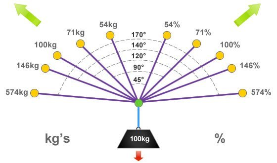

图片来源：https://www.ropebook.com/information/vector-forces/

---

## 来看看具体数字

下面这张很有用的表格，出自 Bob Gaines 和 Jason Martin 合著的 [*《Rock Climbing: The AMGA Single Pitch Manual》*](https://www.amazon.com/Rock-Climbing-Single-Pitch-Manual/dp/0762790040/)。这是我见过的唯一一本提供 ADT 实际数据的书。

第二列中的“V rigging”（V 形配置），指的是一种常规搭建方式：将扁带环分别挂入两个锚点，形成两条支臂，再用绳弯打结固定。

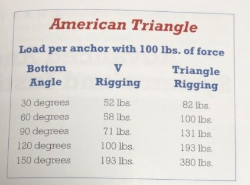

图片来源：Bob Gaines 和 Jason Martin 合著的 *《Rock Climbing: The AMGA Single Pitch Manual》*

**结果是：施加 100 磅力（约 0.445 kN）的载荷，三角形下方夹角较小、约为 30° 时，ADT 保护站每条支臂对应的锚点只承受 82 磅力。** 这比标准 V 形配置下每条支臂约 52 磅力的受力稍大，但远谈不上灾难性。

**即使夹角达到 90°，也就是通常希望控制的最大角度附近，ADT 也只会让每个锚点承受 130 磅力。** 同样，远谈不上灾难性。（如果你的保护点连 130 磅力都承受不了，那你还有严重得多的问题！）

所以你看，载荷放大其实并不是什么大问题！

如果你是工程师，或更习惯通过图示理解问题，想看看背后的数学推导和一些直观图解，可以阅读新西兰 Over the Edge Rescue 的朋友们写的[这篇文章](https://overtheedgerescue.com/rope-rescue/american-death-triangle/)。

---

## 利用相邻的下降环绳降呢？

这个问题我听过好几次：**利用两个相邻的下降环绳降，会不会形成某种危险的死亡三角？** 简短回答是：不会。下降器处形成的夹角很小，因此每个锚点承受的载荷只比你的体重稍大。螺栓锚点可以轻松承受这样的力，而且能承受来自任何方向的载荷，所以不必担心。*（页面底部的 HowNot2com 视频链接中，大约第 12 分钟处有相关测试。）*

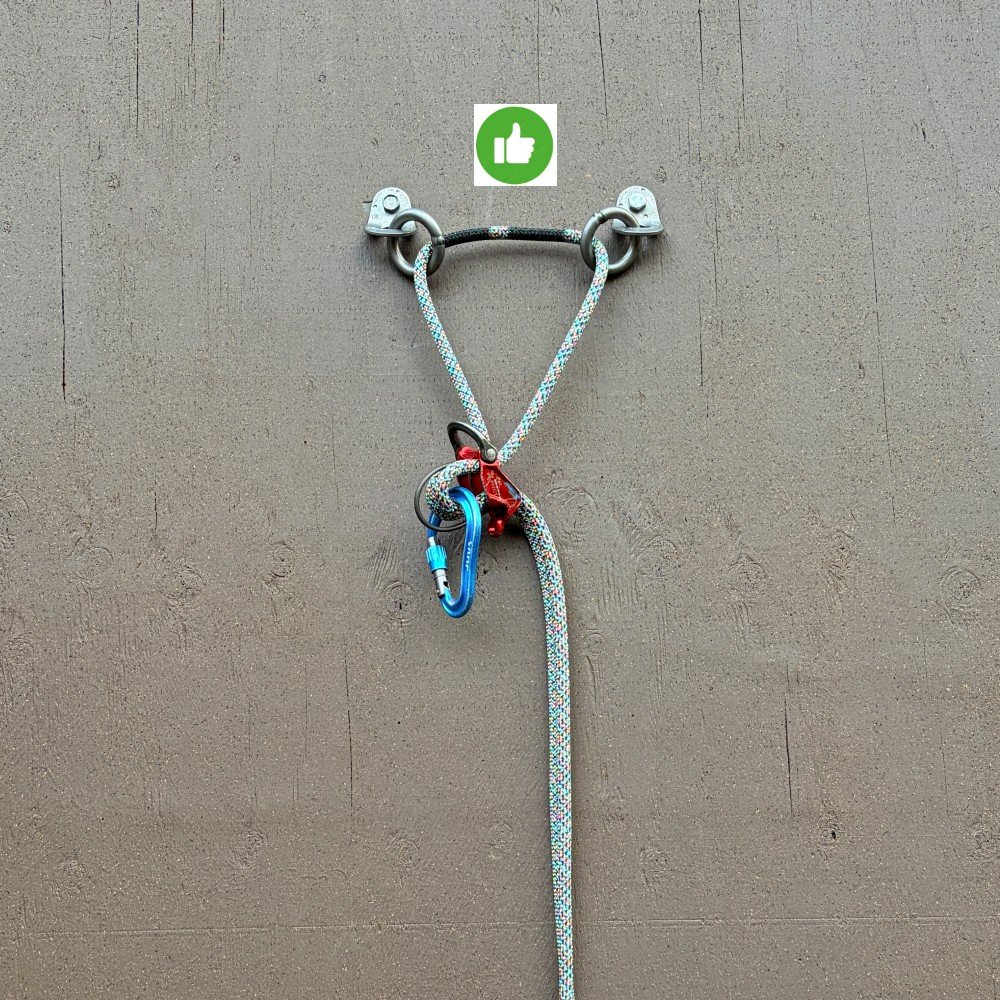

---

## Stone hitch 呢？

下面是类似的情况：在锚点下方打一个 [Stone hitch](https://www.alpinesavvy.com/blog/the-stone-hitch)，将两股绳索隔离，使它们能独立承重，通常是为了可以使用单股绳绳降。

这会在锚点上形成危险的 ADT 吗？它确实是 ADT，但对于图中的螺栓锚点来说，肯定谈不上危险。在绳降中，载荷不会超过 1–2 kN，因此不用担心载荷放大。

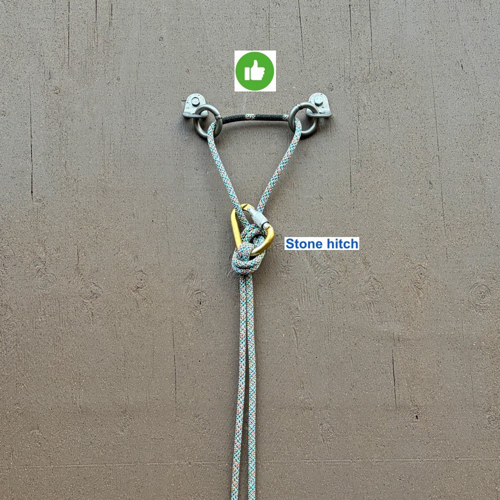

---

### 攀冰的 V 形冰洞呢？

攀冰者通常会用 V 形冰洞（V thread）作为锚点。这本质上也是 ADT。不过，只要在优质冰体中正确制作，它的强度就非常高，锚点受力略有增加并不重要。

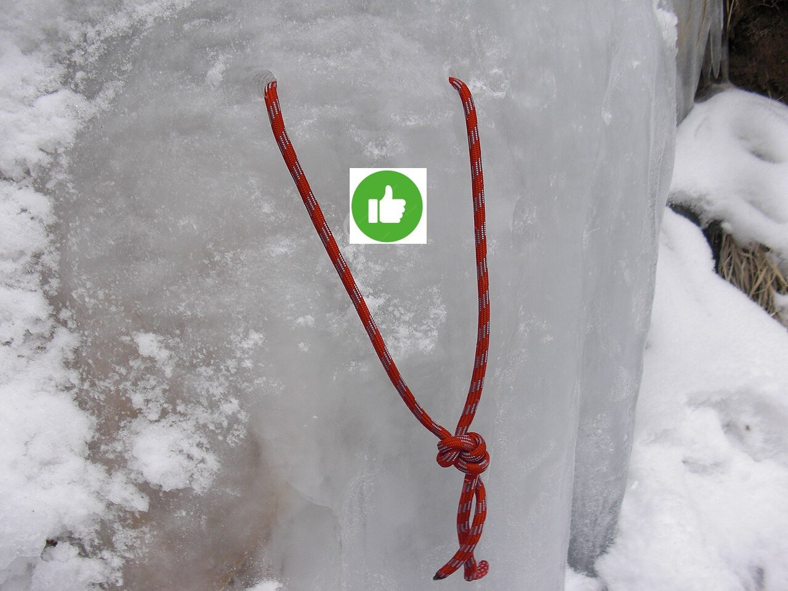

图片：Kumpei Shiraishi，CC BY 2.0，[https://commons.wikimedia.org/w/index.php?curid=62812575](https://commons.wikimedia.org/w/index.php?curid=62812575)

---

## 从相邻线路下放呢？

设想这样一个场景：线路顶端有两组不同的螺栓锚点，而且高度相同。**你先爬左侧线路，挂入一组锚点，然后向右横移，挂入另一组锚点，接着直接下放，而没有先把绳索从第一组锚点中抽出。这会形成某种危险的 ADT 吗？**

答案是：不会。**我的一位聪明的工程师朋友计算过，每组锚点的受力都只比攀爬者的体重稍大。**（更准确地说，右侧锚点承受的力约为攀爬者体重的 1.25 倍，左侧则约为 0.9 倍。）所以结论是：没问题！

如果这样操作，要注意：安全地把搭档下放到地面需要更长的绳索，因此一定要确认绳长足够！

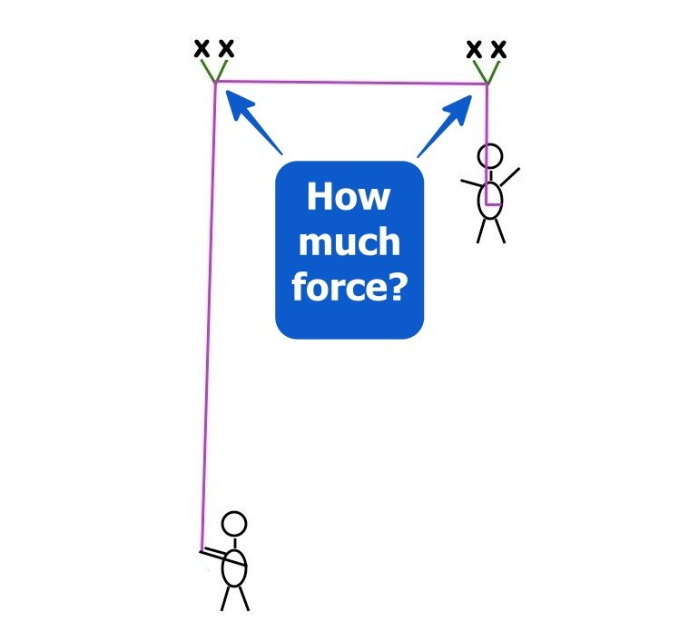

---

## 实际受力是多少？

在页面上方那张“绳降配置”的照片中，连接辅绳两端的绳结位于三角形的水平边上，也就是两个锚点之间。这处绳结承受多大的力呢？

下图中的配置近似等边三角形，三个角均为 60°，连接绳结位于两个锚点之间。假设保护站下悬挂着一个 100 kg 的重物。**绳结承受的力会小于、等于，还是大于这个 100 kg 重物的重力？猜猜看！**

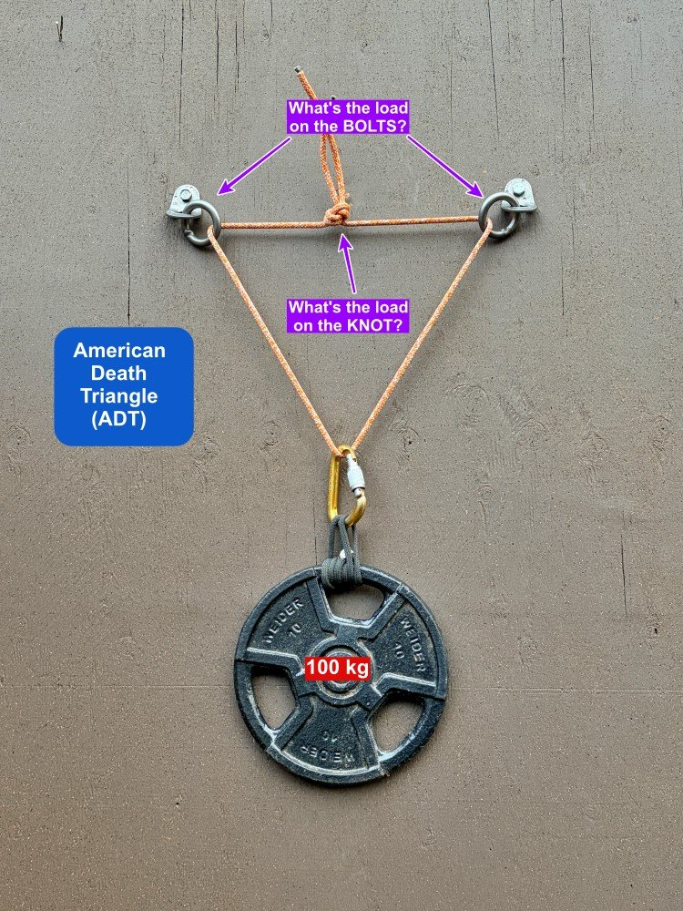

答案是：小得多。原因是每个锚点处的摩擦承担了一部分载荷。具体大小取决于所用材料有多光滑，以及它在锚点处穿过的具体是什么部件；但要点是，三角形的水平边受力最小。你觉得意外吗？我当时也觉得意外！

*（关于下图的说明：是的，我知道可以直接把绳索穿过下降环，完全不用这套 ADT 配置；但为了用手头这段长度的辅绳搭出等边三角形，我才这样布置…… =^）*

理论上，每个螺栓锚点承受的力都应与总载荷相同，也就是 100 磅力。但由于辅绳穿过下降环，摩擦实际上会减小传到挂片上的力，这是好事。在夹角为 60° 的等边三角形配置中，每个螺栓锚点承受的力约为总载荷的 80%，而绳结处约为 36%。

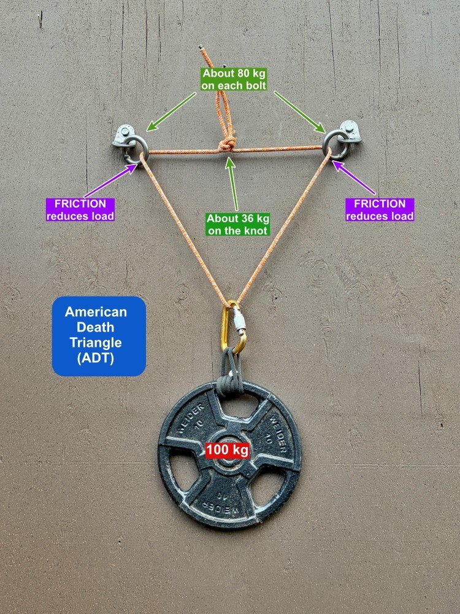

---

### 下图是 HowNot2.com 的朋友们测试几乎相同配置时的视频截图。

### **主连接点（masterpoint）上的载荷为 2.4 kN 时：**

- 两个锚点之间的三角形水平边承受 0.9 kN 的载荷，**约为总载荷的 36%。**
- 每个螺栓锚点承受 1.96 kN 的载荷，**约为总载荷的 80%。**

（页面底部有完整视频的链接。）

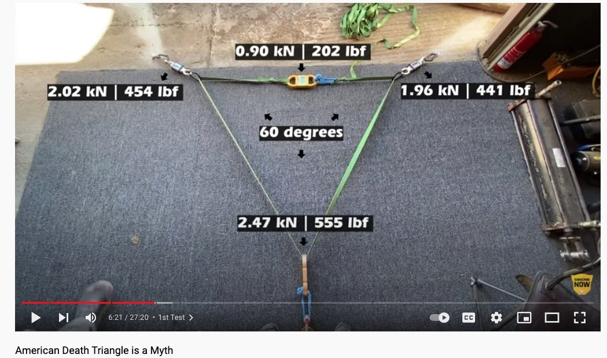

图片来源：HowNot2

---

- *什么是“合力”（resultant），它与这种配置有什么关系？*
- *ADT 会对哪一种特定的攀岩保护器材造成问题？*
- *想看一段对 ADT 进行实际拉断测试的 YouTube 视频吗？*

### 加入我的[**高级会员**](https://www.alpinesavvy.com/premium)，阅读本文剩余部分。

### 感谢你的支持！
