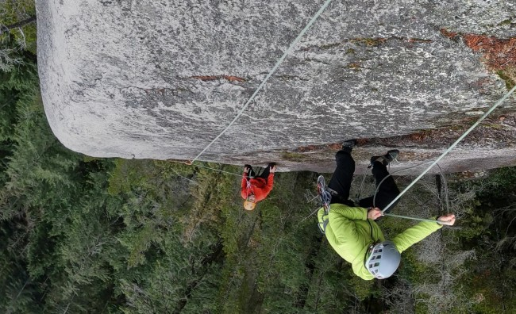
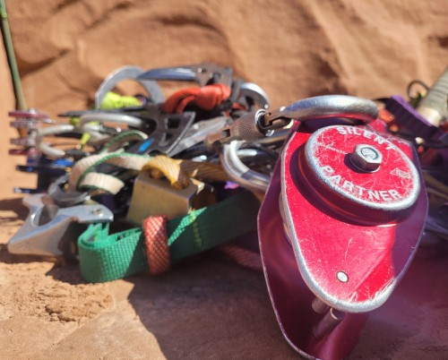
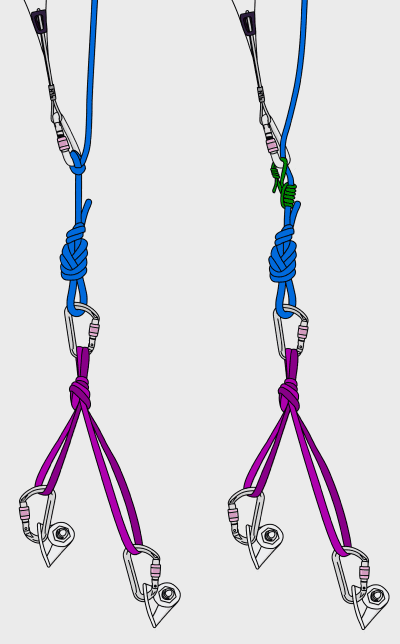
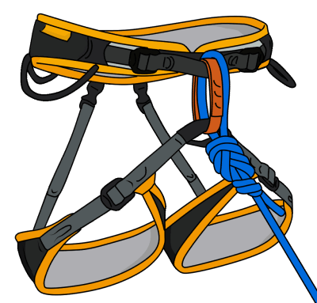
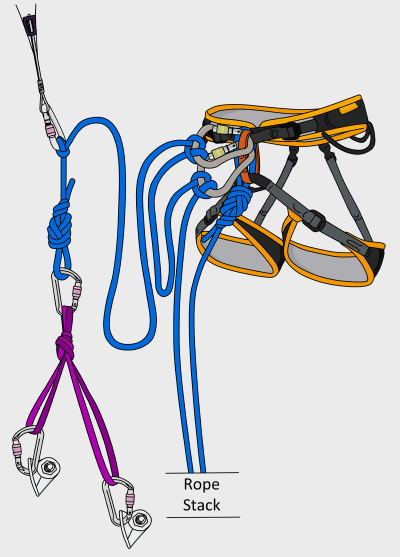
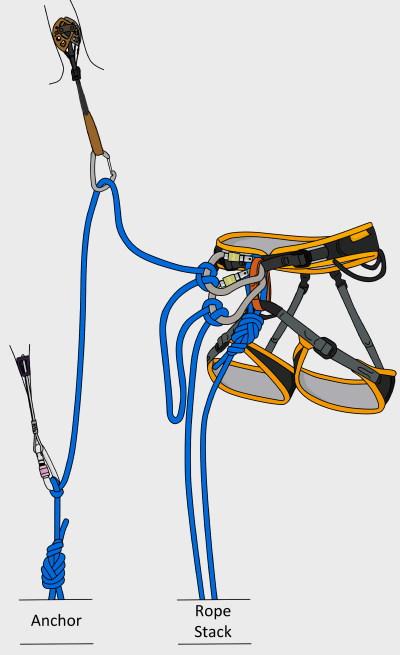
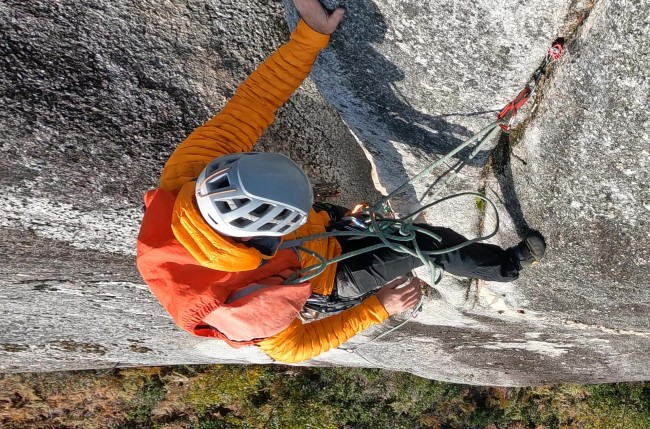
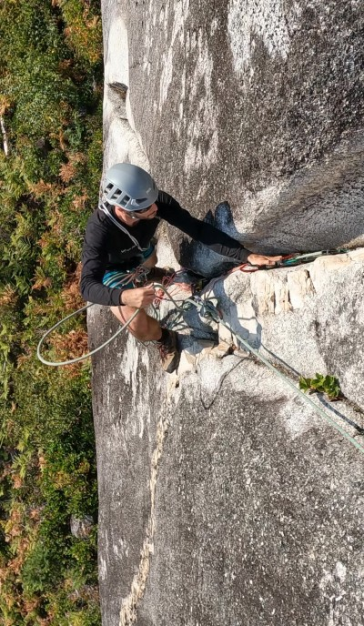
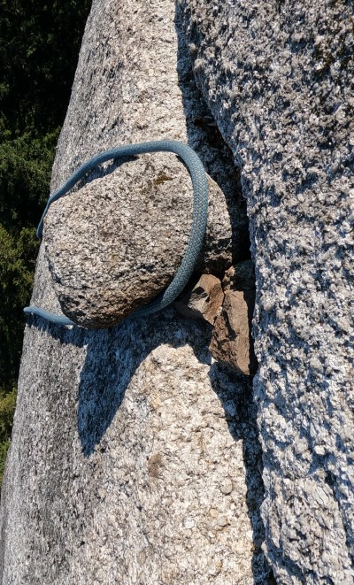
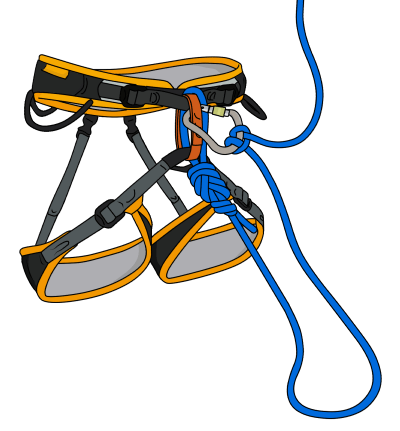

# Self Rescue: Rope Soloing

- Author: VDiff Climbing
- Source: [VDiff Climbing](https://www.vdiffclimbing.com/rope-solo/)

Rope soloing is a technique where you belay yourself instead of being belayed by your partner. You can use this technique to lead or top rope belay.

More complicated techniques are needed to solo an overnight alpine route or aid-solo a big wall. These skills are outside the scope of this article. Only the basic technique is described here.

Times when you may need to rope-solo include:

- Climbing up to reach an injured leader after escaping the belay
- Assisting an injured partner who cannot belay and when the easiest way out is up
- Setting up a top rope anchor by yourself

## Rope Solo Devices

Devices exist which are specifically designed for rope-soloing (such as the Silent Partner). Assisted braking belay devices (such as the GriGri) work to some extent, but are fairly unreliable for rope soloing and must be backed up with the technique described here anyway.

In keeping with the improvised character of self-rescue, we will assume that you don't have a rope-solo device with you.

## How to Rope Solo – The Basics

**Step 1**
Build a bomber, multi-directional anchor (a bolted anchor is best when first learning this technique) and tie one end of the rope to it. This anchor primarily needs to hold an upwards pull.

You can maintain the position of the anchor by tying a clove hitch to a separate piece of gear above the anchor as shown (other knots work too, such as the alpine butterfly, but the clove hitch is much easier to cinch tight).

Alternatively, you can use a prusik to maintain the anchor's position. Be aware that prusiks may slip when left on an unattended, moving rope like this.

If it is critical that your anchor stays in position, use the clove hitch technique instead.

**Step 2**
Tie in to the other end of the rope.

**Step 3**
Stack the rope neatly so that it feeds out from both ends. The rope will feed out twice as fast from the anchor side than from your tie-in side, so factor this in when stacking.

**Step 4**
Pull a few meters of rope through from the anchor side and tie a clove hitch to a screwgate. Attach this to your belay loop. This is your primary tie-in point.

**Step 5**
Tie another clove hitch a couple more meters further down the rope. This is your back up.

**Step 6**
You are now ready to climb. As you ascend, place gear on the rope between your primary clove hitch and the anchor.

**Step 7**
You'll need to adjust your clove hitch just before the rope comes tight. Pull up a few meters of slack rope, tie another clove hitch, then remove the old one.

Remember that the extra slack from untying will add to the distance you can fall as well as the distance you can climb up. Re-tie the clove hitches as often as you need to keep yourself safe.

### Alternative Rope Solo Method

The main reason to be tied into the end of the rope is so that it's impossible to become completely detached from the system. Depending on your level of competence with rope-soloing, you may choose to only be attached to the system via the clove hitches. This means you have less rope hanging from your harness and therefore less chance of a loop getting caught on something out of reach below.

A good compromise is to carry the rope with you in a backpack while climbing. Tie into the end of the rope and stack it inside the backpack (your tie-in end is stacked at the bottom). Keep your backpack open so you can pull rope out easily while you climb.

## Rope Soloing Dangers

### Rope Management

One of the main difficulties of rope soloing is judging the amount of rope you need to get to the next gear placement or good stance.

Due to the extra slack in the system, you will need to place gear more frequently than you would when being belayed by a partner, especially when climbing off the ground or a ledge. It's a hard balance between having enough rope to move up, and keeping fall potential to a minimum.

### Dynamic Belay

Without a partner, you will not have a dynamic belay. This means more force is applied to your gear in a fall – another reason to place solid gear more frequently.

### Stuck Ropes

Another common problem (especially on lower-angle terrain, or if it's windy) is getting a loop of rope stuck on something.

You can reduce these dangers by:

- Placing good gear more frequently than you normally would.
- Identifying upcoming gear placements before you reach them.
- Making sure you don't need to re-tie your clove hitches in the middle of a difficult move.
- Only climbing terrain you find easy.
- Having a sling pre-attached to your belay loop. This allows you to quickly clip in to a piece of gear – useful for getting your hands free to adjust knots.
- Managing your rope well. If your rope is likely to get stuck far below, you could carry it in coils on your harness (this works better higher up the pitch when there is less rope to deal with), or take it with you from the start in a small backpack.

## Top Rope Self-Belaying

Other situations exist where you may need to self-belay up a rope above you. For example, if the rope above gets stuck when you're following a pitch. A solution would be to self-belay to the point where the rope is stuck.

In most situations like this, the rope remains still while you ascend. Simply climb up and tie backup knots as you go.

Depending on the situation, you may reach a point where you can be put on belay. In this case, you should adjust the backup knots while the belayer takes in rope. This ensures that you do not create unnecessary fall potential while the rope is being taken in.

