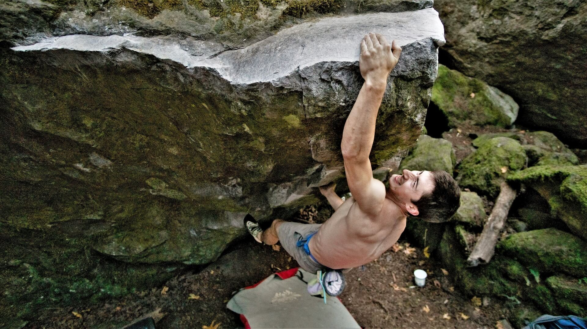

# Eric Hörst「7-53」指力训练计划（案例研究）

- 作者：Jędrzej Banaszczyk
- 发布日期：2021 年 2 月 28 日
- 更新日期：2026 年 5 月 27 日
- 原文：[StrengthClimbing](https://strengthclimbing.com/horst-finger-strength-training-program/)

## 内容提要

**Eric Hörst 的「7-53」方案**是一套高强度负重指力板（hangboard）训练，目标是用很低的训练量提高最大指力。

在这个案例里，Carson 在继续正常攀爬的同时，只用 8 周就把**相对体重的指力提高了 17%**。

### 要点

- 「7-53」用**很短的最大强度悬挂，配合很长的休息**
- 训练量低，周期中仍可以**继续高强度攀爬**
- 对**最大指力**的发展效果很好
- 指力涨得太快时，如果攀爬量也跟着猛加，**过度使用损伤**的风险会上升
- 适合**中级和高级攀岩者**，不适合作为第一套指力板方案
- 一条稳妥的进阶路径是：7/3 重复悬挂（7/3 repeaters）→ 密度悬挂（density hangs）→ 轻量最大悬挂（light max hangs）→「7-53」

## 引言

2020 年 11 月，我收到读者 Carson 的邮件。他来问指力板训练该怎么安排。Carson 已经是一名相当有成绩的年轻抱石者，但还想靠进一步提高指力，把水平再抬上去。

他后来以 Eric Hörst 的「7-53」指力训练计划为底，自己排了一套训练，8 周内指力就有了很大提高。我觉得这个案例很有意思，也很鼓舞人，于是在征得他同意后，把他的结果写出来。

## 指力分析器 2.0 的初始结果

Carson 先说明了自己的训练情况和近期成绩。他用我的[指力分析器 2.0（Finger Strength Analyzer 2.0）](https://strengthclimbing.com/finger-strength-analyzer/)估算当时的抱石水平 [1](#ref-1)。输入如下：

- **身高/指距（Height/Span）：** 6 英尺 0 英寸（约 1.83 米）
- **体重：** 157 磅（约 71.2 千克）
- **训练模式 1：** 每周至少两次，包含负重悬挂
- **边深：** 18 毫米（[Metolius 木质横杠](https://www.metoliusclimbing.com/campus_rungs.html)）
- **悬挂时间：** 7 秒
- **附加重量：** 70 磅（约 31.8 千克），总负荷 227 磅（约 103.0 千克）
- **引体向上：** 3RM，+75 磅（约 34.0 千克）
- **算出的舒适攻坚难度：** V6–V7

这个结果和他当时的抱石能力相符。他不久前刚旅行回来，完成了两条 V6 和两条 V5。个人最好成绩是 V7/V8，但那条线他攻坚了 3 个月。Carson 还说，自己拉力强，仰角和挤压线路表现好；小点的技术性直壁则偏弱。

## 此前的指力训练

疫情之前，Carson 不做指力板，只抱石。疫情开始后，他按下面的安排认真练了起来：

- **周一：** 单臂 Recruitment Pulls 5 次。做法受 Tyler Nelson 启发：脚踩在地上，做最大等长收缩 [2](#ref-2)
- **周三：** 户外抱石；下雨就去岩馆
- **周五：** 7/3 重复悬挂，5 组，每组 6 次
- **周六/周日：** 大约每两周攀一次

这套自己排的简单训练，把他的抱石水平从 V4/V5 带到了 V6/V7。值得注意的是，训练量其实不高：每周只有 2 次短的指力板课，外加 1–2 次攀爬。即便如此，也够他进步 1–2 个 V 级。

这时 Carson 准备把训练再上一个台阶，于是来问我：网站上的哪套计划，最适合他在接下来几个月里继续长指力。

## 怎么选指力板方案

我们先讨论了 Carson 还能用哪些指力板方法继续发展指力。运动员做指力板还不满一年时，我通常建议先做几个周期的[7/3 重复悬挂](https://strengthclimbing.com/hangboard-repeaters/)，强度取 7 秒最大负荷的 80% [3](#ref-3)。目的是先长一点肌肉、把结缔组织练结实，再去承受更重的负荷。但 Carson 打定主意，要马上练最大力量。

他已经用 Recruitment Pulls 练了几个月，我觉得继续做高强度或许可以。另一条路是 Eva López 的 MaxHangs：如果选较轻的版本，它会是负重悬挂很好的入门 [4](#ref-4)。比如可以从强度 85% 的 15 秒悬挂开始，这只比 7/3 重复悬挂的常用负荷稍重一点。

Carson 还是选了 [Hörst 的「7-53」方案](https://strengthclimbing.com/eric-horst-7-53-hangboard-routine/)。在我看来，它已经接近强度范围的最顶端 [5](#ref-5)。这里必须说明：Carson 并没有正式加入我的任何训练计划，他只是来征求意见，所以我也不便断然劝他放弃这套激进安排。

不过，虽然有一点风险，他的选择也并非不合理。他年轻，恢复快，而且此前已经做过负重训练。我仍然认为，他用没那么激进的方案还能获得很多进步。我同意 Eva López 的看法：应当尽量用最小的刺激换取进步，这样才不会让进步过早撞墙。

## 攀爬训练计划的具体安排

讨论之后，Carson 为自己排了下面这套计划：

- **指力板课：** Eric Horst 的「7-53」方案（[表 1](#table-1)）
- **周期长度：** 8 周
- **结构：**
  - 每周两次，每种手型 1 组：
    - 半扣（half crimp）
    - 带拇指包握的全扣（full crimp with a thumb wrap）
    - 四指开手（4 fingers open hand）

每组是 3 次悬挂：用力 7 秒，休息 53 秒。半扣的 7 秒最大自主收缩负荷（MVC-7）从 90% 起练，相当于 205 磅（约 93.0 千克）。每次指力板训练他都试着把负荷加 2 磅（约 0.9 千克）。每第 4 周减载（deload），改用更轻的重量。照这个算法，到周期结束，半扣训练负荷会增加 6 × 2 = 24 磅（约 10.9 千克）。

因此，最后一次训练中，半扣用 229 磅（约 103.9 千克），全扣用 219 磅（约 99.3 千克），四指开手也用 219 磅。他预计周期结束后，半扣的 MVC-7 为 229 磅 / 0.96 = 239 磅（约 108.4 千克）。如果一切按计划走，8 周内半扣力量提高 5%——目标定得相当高。

每次指力板课后，他会接着做负重引体向上、吊环臂屈伸（ring dips），以及核心和拉伸。

每周再去一次抱石或运动攀。

**表 1：**「7-53」指力方案摘要。

| 「7-53」方案 | |
| --- | --- |
| 悬挂测试时间［秒］ | 10 |
| 余量（margin）［秒］ | 3 |
| MVC-7 负荷 | 92–97% |
| 组数 | 2–5 |
| 每组手型数 | 1 |
| 每种手型的悬挂次数 | 3 |
| 悬挂时间［秒］ | 7 |
| 次间休息［秒］ | 53 |
| 组间休息［分钟］ | 3 |
| 张力时间（TUT）［秒］ | 42–105 |
| 总时间［分钟］ | 7–23 |

## 训练结果

8 周计划顺利做完后，Carson 去测 18 毫米边上的半扣力量。他按平时的方式热身，测试悬挂从 216 磅（约 98.0 千克）开始，顺序如下：

**第 1 次：** 216 磅 — 10 秒以上  
**第 2 次：** 235 磅（约 106.6 千克）— 10 秒以上  
**第 3 次：** 245 磅（约 111.1 千克）— 9 秒以上  
**第 4 次：** 255 磅（约 115.7 千克）— 9.2 秒！！  
**第 5 次：** 260 磅（约 117.9 千克）— 5.2 秒！！

260 磅那次之后他停了下来，因为落地时肱桡肌（brachioradialis）感到疼痛。不过他能把 255 磅抓住 9 秒以上，因此可以预期 7 秒能抓住 262 磅（约 118.8 千克）。

这大约是 MVC-7 增加了 30 磅（约 13.6 千克）。涨幅相当惊人。体重从 157 磅涨到大约 161 磅（约 73.0 千克），相对体重的 MVC-7 在八周里仍然提高了 17%。我把新数据输入[指力分析器 2.0](https://strengthclimbing.com/finger-strength-analyzer/)，如下：

- **身高/指距：** 6 英尺 0 英寸
- **体重：** 161 磅
- **训练模式 1：** 每周至少两次，包含负重悬挂
- **边深：** 18 毫米
- **悬挂时间：** 7 秒
- **附加重量：** 99 磅（约 44.9 千克），总负荷 260 磅
- **引体向上：** 关闭
- **算出的舒适攻坚难度：** V9

8 周训练，指力提高 17%！

**照片：** Carson 在一条较难的项目上发力（摄影：Andrew Child，Instagram：@iamandrewchild）

## 结果分析

计划做完后的进步看起来好得惊人。Carson 也很热心，讲了他自己的判断。他认为指力涨得这么猛，有几个原因，最大的一个是：他以前从没做过这套指力板方案。尽管已经攀了五年，仅仅是学会更高效的动作和手型，就还有很大空间。我的看法是，五年抱石给 Carson 打下了相当扎实的基础，正好可以做神经募集；负重训练最终也确实有了回报。

另外，复测那天更冷，可能会影响指力板上的摩擦，但没有精确数据就很难判断。以我的经验，木质表面的摩擦有一个最合适的温度区间。太冷的话木头会变滑，测出来的数会偏低。

除此之外，Carson 承认自己过去热身可能并不充分。热身是任何一次训练都不可少的部分，结尾还应该做一组较重的募集悬挂，让前臂屈肌产生激活后增强（postactivation potentiation，PAP）。想进一步了解热身的重要性，可以读[这篇文章](https://strengthclimbing.com/9-powerful-reasons-to-warm-up-for-rock-climbers-review/) [6](#ref-6)。

最后，Carson 有意增重了 4 磅（约 1.8 千克），其中大部分看起来是肌肉。他认为肩和前臂哪怕只有一点点肌肥大，差别也会很明显。处于热量盈余时，他恢复得可能比平时更快。不过我在早先的[一篇文章](https://strengthclimbing.com/8-month-hangboard-finger-strength-training-program-results/)里也写过：即使在减重的 8 个月里，力量仍然可以有明显增长 [7](#ref-7)。关键是在训练大周期（macrocycle）里选对增重和减重的时机。Carson 看来正好做到了这一点。

## 向岩壁的迁移

更值得关心的是，这些训练有多少转化成了岩壁上的表现。2020 年 10 月底他开始这套计划时，指力大约相当于 V8；两个月指力板之后，大约相当于 V9。

Carson 告诉我，计划结束后，他花了一点时间才重新找回岩壁上的动作感觉。而且力量新上来之后，他把攀爬量加得太快，右中指 A2 滑车（A2 pulley）出现了轻度拉伤。这一点很说明问题：变得太强，本身就可能成为过度使用损伤的一条路径。

好在 Carson 用循序渐进的指力板训练来处理这次损伤，大约两周康复后就恢复了。指力板确实可以是很好的恢复工具，因为它能精确、可控地给手指加载。这个话题在[《The Climbing Bible》](https://www.v-publishing.co.uk/books/climbing/climbing-the-climbing-bible/?utm_source=strengthclimbing&utm_medium=blogpost&utm_campaign=the_climbing_bible)里有一些值得看的内容 [8](#ref-8)[9](#ref-9)。

尽管有这次挫折，他还是看到了一些表现上的进步。一条 V8，他第一次上去就把所有动作都抓住了，这是个不错的结果。另一次 Moonboard 训练也很顺利：flash 了 6 条基准线（benchmark）V4，还有一条在第三次尝试时完成。Moonboard 上不少 V4 相当于普通岩壁上的 V6，所以这个成绩不差。而且这是滑车受伤之后的训练，他因此没有去试更难的线。

## 对 Eric Hörst「7-53」力量方案的结论

总的来说，Hörst 的「7-53」被证明是提高最大指力的一种非常有效的方法。计划为期八周。在 18 毫米边、半扣姿势上，Carson 的 MVC-7 从 227 磅提高到 260 磅：绝对值大约提高 15%，相对体重提高 16%。

这套计划训练量低，Carson 可以把指力板和常规攀爬、抱石排在一起。遗憾的是，计划结束后他在抱石时伤了手指，没能马上把新获得的力量用足。

这套安排完全是 Carson 自己排的。虽然量不大，训练负荷超过了 MVC-7 的 90%，策略相当激进。如果你才开始认真做指力板，我建议先扎实地做几个周期、强度 70%–80% 的 7/3 重复悬挂，再加上 Tyler Nelson 的密度悬挂。其后可以接 Eva López MaxHangs 的轻量版本、[Bechtel 的 Ladders](https://strengthclimbing.com/steve-bechtels-3-6-9-ladders/)，或者 GO 30–100 计划 [10](#ref-10)[11](#ref-11)[12](#ref-12)。在最终必须做很重的悬挂之前，低强度训练里还有很多进步可挖。

你也可以加入我的个性化训练计划。我会为你选定合适的指力板课，确定训练负荷和边深，并保证进步安全、稳定。有问题请写信到 [contact@strengthclimbing.com](mailto:contact@strengthclimbing.com)。

## 参考文献

1. J. Banaszczyk，StrengthClimbing —《攀岩指力分析器 2.0》（Climbing Finger Strength Analyzer 2.0），2020 年 6 月 25 日。[（链接）](https://strengthclimbing.com/endurance-repeaters/)
2. T. Nelson，Camp4HumanPerformance.com —《“最简单”的手指训练计划》（The “Simplest” Finger Training Program），2019 年 10 月 16 日。[（链接）](https://www.camp4humanperformance.com/blog-2/2019/10/16/dr-tyler-nelson-the-simplest-finger-training-program)
3. J. Banaszczyk，StrengthClimbing —《指力板重复悬挂：力量耐力方案》（Hangboard Repeaters strength endurance protocol），2019 年 4 月 8 日。[（链接）](https://strengthclimbing.com/hangboard-repeaters/)
4. Eva López Blog —《指力板训练指南（II）：最大抓握力量与耐力方法，以及负荷管理》（Fingerboard Training Guide (II)），2018 年 5 月 23 日。[（链接）](https://en-eva-lopez.blogspot.com/2018/05/fingerboard-training-guide-II-Maxhangs-SubHangs-and-Inthangs-methodology.html)
5. J. Banaszczyk，StrengthClimbing —《Eric Hörst 的「7-53」指力板常规训练》（Eric Hörst’s “7-53” finger strength hangboard routine），2019 年 1 月 21 日。[（链接）](https://strengthclimbing.com/eric-horst-7-53-hangboard-routine/)
6. J. Banaszczyk，StrengthClimbing —《攀岩者热身的 9 个有力理由（综述）》（9 Powerful Reasons To Warm-Up For Rock Climbers），2020 年 12 月 4 日。[（链接）](https://strengthclimbing.com/9-powerful-reasons-to-warm-up-for-rock-climbers-review/)
7. J. Banaszczyk，StrengthClimbing —《8 个月指力板指力训练计划的结果》（8-Month Hangboard Finger Strength Training Program Results），2020 年 3 月 31 日。[（链接）](https://strengthclimbing.com/8-month-hangboard-finger-strength-training-program-results/)
8. M. Mobråten、S. Christophersen，《The Climbing Bible》— 攀岩的技术、体能与心理训练，Vertebrate Publishing，2020 年 9 月 3 日。[（链接）](https://www.v-publishing.co.uk/books/climbing/climbing-the-climbing-bible/?utm_source=strengthclimbing&utm_medium=blogpost&utm_campaign=the_climbing_bible)
9. J. Banaszczyk，StrengthClimbing —《The Climbing Bible》书评，2020 年 9 月 2 日。[（链接）](https://strengthclimbing.com/the-climbing-bible-review/)
10. J. Banaszczyk，StrengthClimbing —《Eva López MaxHangs 指力板指力训练》（Eva López MaxHangs hangboard routine for finger strength），2019 年 4 月 29 日。[（链接）](https://strengthclimbing.com/eva-lopez-maxhangs/)
11. J. Banaszczyk，StrengthClimbing —《Steve Bechtel 的 3-6-9 Ladders 指力板训练》（Steve Bechtel’s 3-6-9 Ladders hangboard finger strength training），2019 年 5 月 18 日。[（链接）](https://strengthclimbing.com/steve-bechtels-3-6-9-ladders/)
12. S. Bechtel，《The Climb Strong Hangboard Manual》［电子书］，2018 年。[（链接）](https://www.climbstrong.com/product/the-climb-strong-hangboard-manual/)
